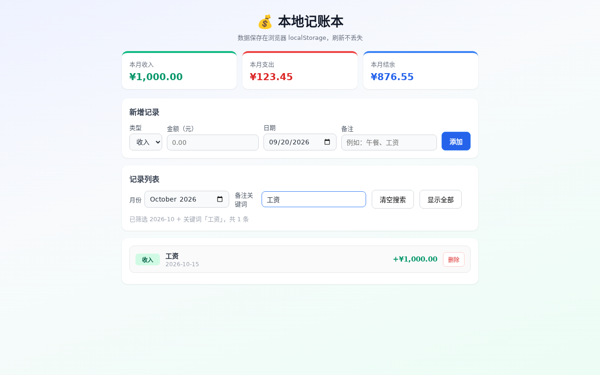

# 真实语义 KV 回收功能验证：记账网页与同会话追加功能

本次一例真实任务通过：模型先创建本地记账网页，再在同一 DSH 会话中增加关键词搜索。第二阶段触发实际回收后正常完成，独立浏览器通过 86/86 项状态检查。没有人工改写模型生成的网页代码。

这是一条已落盘代码正文的语义回收路径，验证了真实来源、原生退休、CPU 释放、窗口切换和任务继续执行。它不代表默认统计阈值、R-KV、模型裁判或零吞吐损耗已经通过验证。

## 配置与范围

| 项目 | 本次实际设置 |
| --- | --- |
| 设备与模型 | 云端单张 RTX4090；sokada4/Qwen3.8-27B-GPTQ-Int4 |
| 模型版本 | 2232b67a2ef5480e97c4450838a712de1346eccc；hf-mirror.com；下载校验通过 |
| 并发 | GPU 模型请求串行，max_num_seqs=1，桥接 max_inflight=1 |
| KV / 生成 / 逻辑上下文 | 36,864 / 16,384 / 262,144 tokens |
| CPU 历史预算 | 12 GiB；repository_blocks=8196 |
| 执行 | BF16 计算、FP8 e4m3 KV、eager、MTP 1；原生 prefix cache 与 async scheduling 关闭 |
| 其他 | prefill 128、Query replay 128；解析后的 native batch 上限 130；P/M checkpoint |
| 运行代码 | f26e947636f049b02cad636b71f379e8dfab3999 |

最大 API 逻辑总长度为 19,354 tokens，因此本次证明的是未到 36K 压力线时的主动回收，不是跑满 256K 的质量压力测试。两次用户 Query 属于同一任务会话，模型请求之间没有并发。所有推理和浏览器验收都在云端执行。

## 信号与共存协议

DSH 桥接只为已经执行成功、且内容与磁盘文件逐字节相同的 write 产生凭据。正文坐标来自实际接受的 token bytes，使用完整前缀 SHA256、会话 namespace、generation、evidence revision 绑定。只注册正文内部完整 32-token 块；路径、工具框架、混合边界块和结果凭据保留。其他工具创建的 index.html 没有被自动标记为候选。

本次记录的是一次真实文件一致性观测：importance=1、cold=false，没有虚构低注意力或三次冷观测。实验显式使用 min_observations=1、min_cold_observations=0、max_importance=1，mode=delete、policy=statistical、proactive=true。默认的 3/3/0.1 阈值没有改变。这组参数验证文件回收机制，尚未校准通用统计策略。

P/M 保护不在 decode 中强制移除。下一次已验证的用户 Query 显式 force 重选；短历史也允许触发，预约上限取实际物理历史与 K 的较小值。先通过原生拾取、装配和围栏提交不含候选块的新窗口，再由正常 checkpoint 替换释放旧保护，原生后台线程完成退休与 CPU 回收。分支 rewind 后重新绑定有效 generations。

## 实际证据

| 来源正文 | 回收完整块 | 回收 tokens | 后续活动窗口中的旧候选块 |
| --- | ---: | ---: | ---: |
| style.css | 60 | 1,920 | 0 |
| app.js | 51 | 1,632 | 0 |
| 合计 | 111 | 3,552 | 0 |

窗口交接时历史前缀为 10,496 tokens，保留窗口变为 6,944 tokens；配置的 K 仍为 36,864。候选专属、live-scope 的 CPU 释放完成记录为 111。首次保存到有释放记录的模型回复以后，又完成 13 个模型回复，随后自然结束第二阶段。两阶段共 21 个模型回复、20 次工具调用、8,424 个输出 tokens；20 次完整接受前缀复用，未发生输出截断。

创建阶段用时 224.722 秒，追加搜索阶段用时 121.383 秒，均以 completed 结束，DSH 最终 exit_code=0。第二阶段实际读取已有代码，再完成修改和语法检查；工具读取重新带回所需文件内容，属于本条语义回收路径的预期行为。

会话清理后的总 CPU 释放计数为 636，包含正常终止、短请求诊断和 owner 清理，不能当作 GC 成效。111 的成效数字来自候选 handle、正文坐标与 live-scope 释放事件的关联，且在 owner 清理前冻结。

## 独立浏览器验收

48 次实际操作，86/86 项状态检查通过，无页面异常、console error、HTTP error 或操作错误。覆盖新增收入 1,000、支出 123.45、余额 876.55、跨月记录、月份与关键词联合过滤、无匹配搜索、清空搜索、删除取消/确认、刷新后保留以及其他月份记录不丢失。

验收口径为当前自然月卡片汇总不受搜索影响；月份筛选切换记录列表。模型实现的清空搜索同时重置月份筛选，这一点在样本 README 中保留。未要求筛选控件状态在刷新后保持。

初次截图检查发现验收环境缺少中文字体。补齐隔离浏览器的 Noto CJK/Emoji 字体后，保持网页文件与测试计划不变复验，再次通过 86/86，中文与 Emoji 截图显示正常。

## 修正与验证

此前接入轮次不作为成功样本：第 12 轮暴露了 archive ID 与活动请求 ID 不同、工具结果格式过窄；第 13 轮在低于 K 时跳过重选，P/M 保持候选保护，删除为 0；第 14 轮实际触发 force 后，错误地按 K 预约小于 K 的历史，第二阶段在删除前失败。上述问题已修正。后续先用独立 1K 输入 / 32 输出短请求验证 GPU force Query 与释放通过，再跑本次真实两阶段任务。短请求没有注入 GC 候选，不计作真实 GC 证据。

验证包含 199 项相关 Python 检查通过、34 项跳过；4 项证据解析检查通过；原生 C++ policy 检查通过。原生退休策略保留 mandatory、selection hold、generation、revision 和实际释放完成后的记账保护。

验收后已确认 owner 缺席、requests/owned_blocks/refresh/connector/reservations 为 0，CPU 历史预约为 0，原生页池 44/45 空闲（保留 null page）。模型、桥接与采样服务已停止，GPU 使用为 0 MiB。

## 证据与限制

- [结构化结果、输入任务、逐回复记录和清理证明](benchmarks/qwen38-4090-real-artifact-gc-20261024.json)
- [模型生成的网页、同计划浏览器结果和清理前 worker 证据](benchmarks/samples/expense-tracker-real-gc-20261024/)
- [实验实现与运行说明](verified-artifact-gc.md)

本次未做匹配的 OFF/DELETE 吞吐对照，也没有验证默认统计阈值、thinking 回收、R-KV 或 block graph 联合质量。新 Query 的额外刷新成本和更长任务中的效果，需要独立测量；本次结果不能推出吞吐无损。已落盘或被后续修改替代的正文能够借助工作区文件读取，但没有实现历史文件版本的自动恢复。
