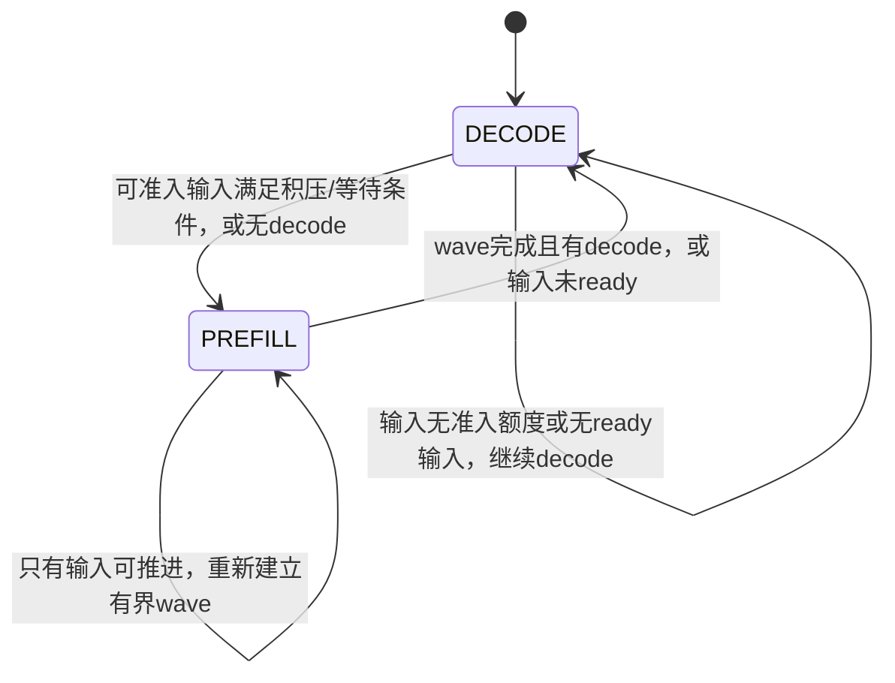

# 单卡按阶段组织 prefill 与 decode

日期：2026-10-16。默认关闭的策略已接入 `phase_policy.py`、`scheduler.py` 和
公共配置验证。相关 CPU 回归 303 项通过、1 项 CUDA opt-in 检查跳过，报告为
`artifacts/public-phase-cpu-20261016-r2.xml`；独立代码复核通过。
冻结实验 `artifacts/timed-public-phases-20261016-r2` 已完成真实模型恢复验收和
一对固定 300 秒性能初测。**公开混批被消除，但尚未达到稳定增益验收标准**，
开关继续默认关闭，未提升为默认配置。
上一版 r1 的恢复执行未报错，但资格负载将长等待和零等待压力屏障混在同组，
未覆盖原检查器要求的旧 TTL 之后热返回；保留失败记录，不记为通过，也未启动
性能窗口。r2 将 P1 长等待热返回与 Ppressure 同步压力回收拆为两组，分别通过
原逐字节检查及 public phase 检查后才启动性能对照；没有降低验收条件。
这组 32K 资格负载验证的是 idle 驻留压力回收，并非 active 容量耗尽后的历史
重选；16 轮性能轨迹也未覆盖全部长历史重选场景，不能扩大本次验收范围。
两组原检查器各证明 8 次恢复，共 16 次；每次覆盖 17 个 attention 层（含 1 个
MTP 层）及 96 个 recurrent 状态张量。最终实际 public forward 混批数均为 0，
提交工作全部确认完成，普通 wave 预算超额为 0，原生请求和 connector pending
均归零。证据为实验目录的 `correctness-gate.json` 和两组原 `restore-gate.json`。
CPU gather 对照已独立完成（87.50 → 91.16 token/s，单对初测）；本方案不修改
该实验、既有默认配置或已冻结源码。

候选配置为 `examples/qwen-nvfp4-phased-offline-agent-k128-g128.json`；性能入口为
`scripts/benchmark_phased_agents.py`。对照两组沿用同一修复后 CPU 路径和 P1
驻留配置，只切换 `offline_phase_policy`，使用相同四用户 16 轮来源轨迹、
两轮预热和各 300 秒窗口。原生/客户端输出计数、未完成请求和全部收尾仍按
[固定窗口协议](fixed-window-agent-benchmark.md) 校验，不把原首 token 删除或延后记账。

## 第一对实测结果

四逻辑用户、NVFP4 权重、FP8 KV、原生 MTP(k=4)，K/G 各 128K、CPU 历史
100 GB、无 SSD。两组仅阶段开关不同，均为持续供给模式；工具返回输入和输出
额度来自同一冻结轨迹，没有执行原 DeepSWE 工具或进行任务准确率评分。

| 完整窗口指标 | 连续调度 A0 | 分阶段 P1 |
| --- | ---: | ---: |
| 有效输出 token | 42,228 | 43,802 |
| 有效输出 token/s | 140.76 | 146.01 |
| GPU 时间加权利用率 | 83.23% | 79.46% |
| 实际 public prefill 完成位置数 | 551,029 | 446,708～454,900 |
| public prefill 完成 token/s | 1,836.76 | 1,489.03～1,516.33 |
| 窗口后收尾（不计入吞吐） | 13.72 s | 43.96 s |
| 同上下文桶四路纯 decode 模型步中位数 | 42.06 ms | 42.61 ms |

输出增加 **3.73%**，但 P1 窗口内少完成约 17.4%～18.9% 的 prefill，留下更多
未完成输入；不能把它解释为同等工作量下确定的总效率提升。prefill 给出完成
fence 的边界区间，不使用包含已恢复历史的原生 prompt 计数。同桶模型步是采样
的 host 模型调用时间（A0/P1 各 577/477 个样本），不是 CUDA kernel 独立计时。
四路 decode 步基本未变，阶段组织并未提高这个计算路径的速度。

实际 public forward 全运行（含预热、收尾）混批为 A0 的 306 次、P1 的 0 次；
P1 全部提交完成，普通 wave 超额为 0。两组 GPU 观察覆盖完整 300 秒，原生
accepted 总量分别为 55,648/57,080，与包括预热、收尾在内的全部客户端流逐项
相符；零原生抢占、零 KV 磁盘读写，最终请求/恢复/connector/owned blocks 均归零。

窗口内双端输出事件的 p95 间隔为 0.429 s → 0.104 s，MTP 事件可包含多个
token，不能称为逐 token 延迟。P1 在 T1 尚有两路未输出首 token，观察到的
TTFT p95 不能直接用于延迟改善结论。阶段化可以集中停顿，不能据零混批宣称
decode 不再受影响：同一输出事件定义下，p99 为 0.800 s → 1.348 s，最大间隔
为 2.200 s → 3.304 s。窗口内全体请求都没有输出的超过 1 秒间隔，从 15 段、
累计 18.78 秒，增加到 71 段、累计 105.17 秒；这不是 CUDA 空闲时间或逐 token
延迟。host 阶段决策停留约 113.06 秒 PREFILL、186.94 秒 DECODE，也不是 GPU
执行占用。因此不能仅用改善的 p95 宣称延迟更平滑。
本次仅一对、仅持续供给模式，未通过三对均改善且中位至少
10% 的既有关卡，也不构成工具等待场景或 SLO 验收。

原始结果见实验目录 `comparison.json`、两组 `saturated/results.json`、
`diagnostic-comparison.json`、`correctness-gate.json` 和 `cleanup-audit.json`。
后续若扩展，应先解耦 native
驻留数与每步并发、实现可恢复的 decode-ready 储备，再检验按 ready 水位补充
prefill 的策略；当前不能宣称已有四路之外的自动替补能力。

## 当前选择与目标

第一版采用 **KVMem 原生调度 gate**：仍是一回合一个请求，在原生模型步边界
决定本批执行 decode 还是一组有界 prefill。暂停计算的请求保留原生身份、active
KV、生命周期额度和检查点契约；阶段切换不取消请求，也不产生工具边界。

这是单卡按时间组织工作的策略，目标为离线有效输出 token/s。它不是多卡硬件
PD 分离，也不承诺降低所有请求延迟或满足 SLO。恢复和 private Query 仍有自身
工作与完成事件，不能将 public batch 阶段隔离宣传成全 GPU 完全没有其他工作。

已有固定 300 秒首对诊断见
`artifacts/timed-agent-20261016-r3/diagnostic-comparison.json`：驻留 P1 的 GPU 平均
利用率 70.81% → 84.44%，历史 KV 上传 201.16 GB → 0，但有效输出只有
85.32 → 89.05 token/s，提升 4.37%。P1 更早进入新任务，窗口内多完成约
19.2万～20.2万 public prefill 位置；新增输入进度不能计为 decode 收益。同上下文
四 decode 模型步中位数约 49 ms，混合步约 662～677 ms，提示可以研究阶段组织，
不能直接推导阶段化一定有效。

## 当前限制：最多四个原生 authority

现有 `max_num_seqs=4` 同时传给 `ReservedKVCacheManager(max_authorities=4)`。
因而不仅每批最多执行四路，GPU active 原生请求也有四个 authority 的准入上限。
暂停的 decode 请求保留 KV 和额度，仍占一个位置。

第一版只在现有额度内组织工作，**不增加四路之外的 CPU/GPU decode-ready 储备**。
若四个位置全由 decode 占用，新 prefill 不能准入，则继续 decode，让请求自然完成
后再获得容量；即使等待超过阈值，也不能强切到一个无法执行任何工作的 PREFILL
阶段。工具等待期间若确无可替补请求，记录供给不足，不能假称可维持四路执行。

更多逻辑用户、可停放的 CPU ready 池，或“驻留请求数”与“每步执行数”解耦是
后续独立功能，不混进本次阶段策略收益。

## 队列与就绪定义

这些是从现有原生队列/事务推导的调度状态，不另造一份请求所有权列表。每个请求
仍只属于原来的 native running 或 waiting/skipped waiting 及对应 KVMem 事务。

| 状态 | 必须满足/等待的条件 | 可计作 GPU decode-ready |
| --- | --- | --- |
| 工具等待 | 外部工具未返回，当前回合已正常结束 | 否 |
| 等待历史/GPU 准入 | CPU 历史增长额度、GPU 生命周期额度或退休位置不足 | 否 |
| CPU 恢复未 ready | gather/H2D、模型状态或恢复事务尚未 commit | 否 |
| Query/重选事务中 | 等待既定私有工作、页表和完成 fence | 否 |
| 普通增量 prefill-ready | 恢复已确认，真实 prompt 尾部尚未计算，且本步可执行 | 否 |
| Query 原子单位 ready | 原请求规划要求完整 replay，已具备原子准入条件 | 否；需独立记录 |
| 纯 decode-ready | 必要输入已完成，无恢复/重选事务、无未完成模型步，原生执行资格有效 | 是 |
| 退休中 | 已结束，但历史/检查点或页面租约仍待确认 | 否 |

不能只用 `is_prefill_chunk` 或“scheduler running 数”判断 decode-ready。需要同时
检查最终计算边界、`num_in_flight_tokens`、`next_decode_eligible_step`、
`transactions`、`prepared_refreshes` 和 connector/native waiting 依赖。

对于刚完成查找的 waiting 请求，应使用原生本次真实计算边界和已验证检查点的
只读提示，不能把 `request.num_computed_tokens=0` 直接当作全量 prefill，也不能把
尚未加载的 CPU 历史当成已完成 GPU 计算。最后一 token prompt tail 仍是 prefill；
它带来的正常首 token 采样是真实输出，不能删除以制造“纯 prefill”日志。

## 固定策略与触发条件

本次候选只新增一项可关闭策略，不扫描 MTP、并发和 chunk 参数：

| 设置 | v0 取值 |
| --- | --- |
| `offline_phase_policy` | 默认 `false`；实验候选显式开启，沿用 `offline_agent_policy` |
| `phase_prefill_wave_tokens` | 8192，按既有 block 对齐并服从 G 和原生容量限制 |
| `phase_max_wait_ms` | 1000；用于等待/阶段重评估的软阈值，不是端到端 SLO |
| 积压请求触发数 | `ceil(max_num_seqs/2)`，当前为 2 |
| 原生执行和 authority 上限 | 仍为 4 |
| 普通 prefill chunk | 仍为 2048，Query 原子边界不变 |

### DECODE 阶段

优先执行真正就绪的 decode。普通 prefill 积累到以下任一条件时，考虑开始一个
PREFILL wave：

1. 没有可执行 decode，但有可执行 prefill，立即处理输入，不等攒满。
2. **实际可执行或可准入的** prefill 积压数达到门槛。
3. 有可执行或可准入的 prefill，其最老等待/持续未推进时间达到 1000 ms。

“考虑开始”仍须复核当前 CPU/GPU 准入及事务依赖。四个 authority 全被 decode
占用时，只有等待的 prefill 不构成可执行输入，不能触发空 wave。门槛中的积压
数量、预计新增 token 工作量和最大年龄都要记录，不能把整个 CPU 历史长度当作
待计算的新输入。

相邻 productive prefill wave 之间，若有就绪 decode，应留出实际 decode 推进，
不能每次耗完 8192 后立刻因同一批长 prefill 重新开 wave，导致驻留 decode 永久
不前进。具体实现需验证至少一个合法 decode batch 能在这种边界得到执行；仅
修改阶段标签而没有真实调度不算推进。

### PREFILL wave

每个原生步重新读取实际可执行候选，但当前 wave 的 8192-token 总预算固定，不随
新请求到达增长。只准入当前阶段合法的普通输入和原请求规划要求的原子 Query；在原生每批
token、MTP lookahead、实际页面及 CPU 历史限制内执行。暂停的 decode 保留全部
KV 和额度。

每步按真实准入的工作扣减 wave 预算；最终 prompt tail 按真实 prompt 位置计，
不能把 MTP lookahead、已恢复的历史 KV 或 graph padding 计成新增 prefill。
若实现使用保守 token 预留，同时分别记录“预留”和“真实提交”量，原生最终
输出及 public work 计数才是实际执行证据。

wave 预算耗尽、候选处理完、没有本阶段可执行工作，或已经提交过输入批次且
wave 用时达到 1000 ms、同时有 decode 可运行时，重新评估：

- 有 decode-ready，回到 DECODE；没有可执行 prefill 时不得为了凑 wave 空转。
- prefill 都在恢复/Query 完成 fence 中等待，则继续推进维护；已有 decode 可以
  执行时回 DECODE，而非让整批陪等。
- 只有输入且没有 decode 时，按新的有界 wave 继续，不要求清空全局队列才退出。
- 请求被预算或容量拒绝，只推迟自身，不阻断同阶段后续合法候选。

### 原子工作与阶段时间

一个必须整体执行的 Query 可以超过本 wave 剩余 token 额度；允许原样接纳该
**单个原子单位**并记录一次 overshoot，随后 wave 结束并重新评估。不能切断
Query、重复评分，或用多个连续原子豁免把 8192 预算变为无界。

1000 ms 是控制器重新评估和饥饿防护的软界。已提交模型步、MTP 验证和原子 Query
不能被墙钟中断；阶段时间可能超过阈值，必须记录实际时长、原子单位、预算超额
及超时原因。不得声称“每一秒必定切换”或把 host 定时器称为 GPU kernel 时限。

两阶段都必须接收已提交工作的完成事件、取消和退休发布。恢复/Query 的私有工作
继续采用现有有界维护调度，单列成本；本版本隔离的是 public batch 选择，不能
据此断言 private Query 和 H2D 永不影响 decode。

## 现有源码落点与不可破坏的契约

- `src/vllm_kvmem/scheduler.py` 的 `schedule()`：在现有完成状态、offline 候选
  和准入预览基础上决策本步阶段；原生 `begin_step()/end_step()` 额度边界保留。
- `_reserve_prefill_lookahead()`：在普通 token/page 分配之前应用阶段 gate，
  保留 MTP padded tail、`plan.admit()`、Query atomic 和 G 约束。
- `_select_waiting_queue_for_scheduling()` 与 `offline_policy.py`：对原生两个
  waiting 队列选择本阶段真正合法的候选，同时保留年龄和会话所有权。
- `_build_kv_connector_meta()`、`_complete_refresh()`：沿用真实事务提交和页表
  更新，不把阶段跳过误当成恢复完成，也不跳过已有的身份/fence 检查。
- `capacity.py`、`session_control.py`、`active_residency.py`：继续唯一负责
  CPU/GPU 准入、精确跨轮恢复、检查点和受压力撤销的 idle active view。
- `work_counters.py` 与阶段决策日志：分别提供真实 public 执行计数和调度原因；
  决策日志不能替代执行证据。

本地原生 `Scheduler.schedule(throttle_prefills=True)` 是有条件的 prefill 延后
提示，`prefill_capacity_bound` 等条件可以覆盖它，且不提供 prefill-only 阶段。
因此不能只复用这个 bool 就宣称严格 gate 已完成。

必须逐项验证：

1. 原生 running 的零 token 路径为 `continue`，waiting 的零 token 路径可能
   `break`。仅对 `_reserve_prefill_lookahead()` 返回零会导致队首阻塞；必须保证
   其他同阶段、可准入 waiting 请求仍可被选择，不能在已分配页面后随意删除输出。
2. `num_computed_tokens` 由原生 schedule/result 更新，MTP 拒绝还会回退。阶段
   gate 不修改它、`num_prompt_tokens`、spec 占位、实际 token IDs 或采样结果。
3. 不借用 `next_decode_eligible_step=2**62` 表示阶段暂停；该哨兵由恢复事务保存
   和还原，借用会冲突。阶段资格应独立表达，完成回调始终工作。
4. 不取消/重启或释放仍在 decode 的 active KV，不制造原生抢占/重算。CPU 历史
   保留、100 GB 上限、推进余量和已承诺的 GPU 生成预算全部保留。
5. MeanK、action attention、query history、guided refresh、必留内容、旧 Query
   和跨轮保持选页的既有语义不变。阶段不是新的评分回合或 Query 边界。
6. Query 和恢复事务进行中、旧 generation 失效、尾 token、MTP 拒绝、取消及退休
   时都能继续完成；没有本阶段可运行工作时允许安全回退，不能出现互等死锁。

## 未采用的编排拆请求方案

曾评估“同一轮先 `max_tokens=1` 完成 prefill 和首 token，正常发布 terminal M，
再用原 prompt＋首 token 恢复生成 `N-1`”的请求编排模拟。它允许 CPU 中保留可恢复
的 ready 池，但**本轮不采用**，原因是它改变请求/退休/评分边界，可能重启 MTP、
改变 action/query-history round 或原生随机数路径，增加检查点与恢复开销。

它不是透明的零输出 prefill；第二段还包含必要的一 token tail。编排层不能安全
暂停仍在执行的第二段，要严格分阶段就得等长请求自然排空，或者再引入生成切片。
这些都需独立证明，不能承诺与单请求逐 token 一致。本轮不以此替代原生 gate，
也不通过它绕过四个 authority 上限。

## 正确性与固定 300 秒对照

先执行 CPU 策略/调度回归：积压数、token 工作量、年龄和无 decode 触发；四个
已有 decode 占满时继续推进；恢复未 ready 不计入就绪；wave 有界、原子单次
overshoot、waiting 队首跳过、两阶段均无就绪工作、取消和老化公平。

随后验证真实模型多用户跨轮热/冷恢复、压力回收、Query 原子边界和 MTP 尾部。
已有恢复 oracle 需覆盖本次阶段暂停/恢复后的 target/MTP KV、recurrent 状态及
完整前缀；最终页/历史额度守恒，无 SSD、容量丢弃或重算。正常 prefill 尾部产生
的首 token 保留并核对原生 accepted 计数，不因阶段标签删输出。

对照两组采用相同 P1 驻留、同一最新 runtime、相同冻结输入/工具/生成额度/等待
计划和四个逻辑用户，只有 `offline_phase_policy` 开关不同。CPU gather 的旧/新
runtime 冷恢复对照是另一实验，不能混入本轮归因。先沿用持续供给控制负载；
需要检验真实工具等待时，再使用同样冻结来源和等待计划单独比较。

双方完成相同固定预热工作，从相同逻辑位置测完整 `[T0,T0+300s)`。窗口包含
阶段切换、恢复、普通/私有 prefill、工具等待、空转和末尾部分输出，不能只按
DECODE 阶段时长作分母。不重置任务、缩短历史，或删除较慢的阶段来提高结果。

主指标仍为全部窗口内实际接受的有效输出 token/s，排除 MTP 拒绝草稿，原生
累计总量与流式输出 ID 交叉核对。另列 GPU 时间加权利用率、public prefill 完成
上下界、phase 时长及原因、wave 预留/实做/超额、private Query 成本、真实
prefill/decode batch 组成、CPU/GPU 等待、hot/cold 恢复、实际队列深度及最老年龄。

尤其记录自然任务换新次数、初始 prefill 工作量、T1 在途和延迟删失。多处理
prefill 不是 decode 提升，观察到的 TTFT p95 也不能忽略未出首 token 的请求。
初对用于判断方向；有明确收益和对应机制后再做 AB、BA、AB 三对。沿用三对均
改善、中位至少 10%、无正确性错误/容量死锁/饥饿的既有关卡，不承诺最优或 SLO。
